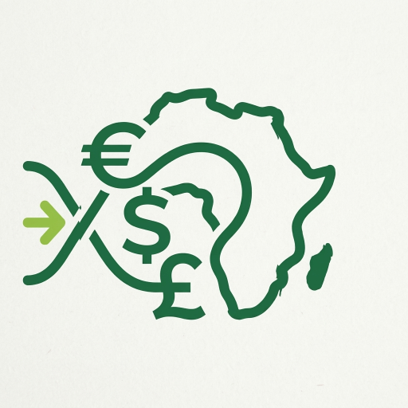

<!DOCTYPE html>
<html lang="en" class="dark" id="html-root">
<head>
<meta charset="UTF-8">
<meta name="viewport" content="width=device-width, initial-scale=1.0">
<title>Xaalya™ | Independent & Free Money Transfer Comparator to Africa</title>
<meta name="description" content="Xaalya is a 100% free comparator, fully independent from fintechs and money transfer operators. Compare real-time exchange rates and fees for transfers to Africa. Zero trace architecture.">
<meta name="robots" content="index, follow">
<link rel="icon" type="image/png" href="assets/logo.png">
<link rel="apple-touch-icon" href="assets/logo.png">
<meta property="og:site_name" content="Xaalya">
<meta property="og:type" content="website">
<meta property="og:url" content="https://xaalya.com/">
<meta property="og:title" content="Xaalya™ - Free & Independent Comparator">
<meta property="og:description" content="Instantly compare the best rates to 42 African currencies. 100% free, neutral, and zero-trace service.">
<meta property="og:image" content="https://xaalya.com/logo.png">

</head>
<body class="bg-slate-950 text-slate-100 min-h-screen font-sans antialiased flex flex-col justify-between">

<!-- Header -->
<header class="border-b border-slate-800/80 bg-slate-950/80 backdrop-blur sticky top-0 z-50">
  

    

      <a href="https://xaalya.com/" class="flex items-center gap-3">
        

          

            
          

          

            XAALYA
            Compare & Transfer with ease
          

        

        FREE & INDEPENDENT COMPARATOR
      </a>
    

    

      <button onclick="openModal('modal-about')" data-i18n="navAbout" class="hover:text-white transition hidden sm:inline-block">About</button>
      <button onclick="openModal('modal-model')" data-i18n="navModel" class="hover:text-white transition hidden sm:inline-block">Our Model</button>
      <button onclick="openModal('modal-faq')" data-i18n="navFaq" class="hover:text-white transition hidden sm:inline-block">FAQ</button>
      <button onclick="openModal('modal-security')" data-i18n="navSecurity" class="hover:text-white transition hidden sm:inline-block">Security</button>
      

        <select id="language-select" onchange="setLanguage(this.value, true)" class="bg-slate-900 border border-slate-800 text-white text-xs font-bold rounded-lg px-3 py-2 focus:outline-none focus:border-brand-500 transition cursor-pointer">
          <option value="en">🇬🇧 English</option>
          <option value="fr">🇫🇷 Français</option>
          <option value="zu">🇿🇦 isiZulu</option>
          <option value="ln">🇨🇩 Lingala</option>
          <option value="sn">🇿🇼 Shona</option>
          <option value="de">🇩🇪 Deutsch</option>
          <option value="ar">🇸🇦 العربية</option>
          <option value="pt">🇵🇹 Português</option>
          <option value="es">🇪🇸 Español</option>
          <option value="zh">🇨🇳 中文</option>
          <option value="it">🇮🇹 Italiano</option>
          <option value="sw">🇰🇪 Kiswahili</option>
          <option value="am">🇪🇹 አማርኛ</option>
          <option value="yo">🇳🇬 Èdè Yorùbá</option>
          <option value="ha">🇳🇬 Hausa</option>
          <option value="wo">🇸🇳 Wolof</option>
        </select>
      

      <button id="theme-toggle" class="theme-toggle-btn" title="Toggle display mode">🌙</button>
    

  

</header>

<!-- Main Container -->
<main class="max-w-4xl mx-auto px-4 py-10 space-y-10 w-full flex-grow">
  <!-- Hero Section -->
  <section class="text-center space-y-3">
    <h2 id="dynamic-hero-title" data-i18n="heroTitle" class="text-3xl sm:text-4xl font-extrabold text-white tracking-tight">You send 300€ to Africa. How much actually arrives?</h2>
    
294 real-time financial corridors. 100% free and neutral comparison.

  </section>

  <!-- Comparator Form -->
  <section class="bg-slate-900/90 border border-slate-800 p-6 rounded-2xl shadow-xl space-y-6">
    

      

        <label for="sourceCurrency" data-i18n="labelSource" class="block text-xs font-semibold text-slate-400 uppercase tracking-wider mb-2">Send currency:</label>
        <select id="sourceCurrency" class="w-full bg-slate-950 border border-slate-800 rounded-xl px-4 py-3 text-white font-semibold focus:outline-none focus:border-brand-500 transition"></select>
      

      

        <label for="targetCurrency" data-i18n="labelTarget" class="block text-xs font-semibold text-slate-400 uppercase tracking-wider mb-2">Receive currency (Africa):</label>
        <select id="targetCurrency" class="w-full bg-slate-950 border border-slate-800 rounded-xl px-4 py-3 text-white font-semibold focus:outline-none focus:border-brand-500 transition"></select>
      

      

        <label for="sendAmount" data-i18n="labelAmount" class="block text-xs font-semibold text-slate-400 uppercase tracking-wider mb-2">Send amount:</label>
        <input type="number" id="sendAmount" value="300" min="1" step="10" class="w-full bg-slate-950 border border-slate-800 rounded-xl px-4 py-3 text-white font-bold focus:outline-none focus:border-brand-500 transition">
      

    

    

      

        
        Converted at global rates
      

      
    

  </section>

  <!-- Results Table -->
  <section id="resultsContainer" class="space-y-4">
    <h3 class="text-xl font-bold text-white flex items-center justify-between">
      Operators comparison
      Ranked by best net rate
    </h3>
    

      <table id="comparisonTable" class="w-full text-left border-collapse">
        <thead>
          <tr class="border-b border-slate-800 text-slate-400 text-xs uppercase">
            <th data-i18n="thRank" class="py-3 px-4">Rank</th>
            <th data-i18n="thOperator" class="py-3 px-4">Operator</th>
            <th data-i18n="thRate" class="py-3 px-4">Exchange Rate</th>
            <th data-i18n="thFee" class="py-3 px-4">Transfer Fee</th>
            <th data-i18n="thReceived" class="py-3 px-4">Amount Received</th>
            <th data-i18n="thDelivery" class="py-3 px-4">Est. Time</th>
            <th data-i18n="thAction" class="py-3 px-4">Action</th>
          </tr>
        </thead>
        <tbody id="operatorsList" class="divide-y divide-slate-800/60"></tbody>
      </table>
    

  </section>
</main>

<!-- MODAL: ABOUT -->

  

    <button onclick="closeModal('modal-about')" data-i18n="closeBtn" class="absolute top-4 right-4 text-slate-400 hover:text-white text-sm font-semibold flex items-center gap-1 bg-slate-800 px-3 py-1.5 rounded-lg border border-slate-700 transition">✕ CLOSE</button>
    <h2 data-i18n="aboutTitle" class="text-2xl font-bold mb-4 text-emerald-400 border-b border-slate-800 pb-2">About Xaalya</h2>
    

      
Xaalya was born out of a simple realisation: the African diaspora deserves completely transparent, impartial and free access to the best money transfer solutions. Unlike traditional comparison sites, Xaalya is not tied to any financial operator.

      <h3 data-i18n="aboutH_mission" class="font-semibold text-emerald-400 text-base">Our mission:</h3>
      
To enable you to compare exchange rates and hidden fees for transfers to 42 African currencies in real time, without any bias.

      <h3 data-i18n="aboutH_commitment" class="font-semibold text-emerald-400 text-base">Our commitment:</h3>
      
To ensure that every cent sent actually benefits your loved ones.

      
<a href="#" onclick="closeModal('modal-about'); openModal('modal-model'); return false;" data-i18n="aboutLinkModel" class="text-emerald-400 hover:underline font-semibold">Want to understand our ethics? Find out more about our model and our independence ➔</a>

    

  

<!-- MODAL: OUR MODEL & INDEPENDENCE -->

  

    <button onclick="closeModal('modal-model')" data-i18n="closeBtn" class="absolute top-4 right-4 text-slate-400 hover:text-white text-sm font-semibold flex items-center gap-1 bg-slate-800 px-3 py-1.5 rounded-lg border border-slate-700 transition">✕ CLOSE</button>
    <h2 data-i18n="modelTitle" class="text-2xl font-bold mb-4 text-emerald-400 border-b border-slate-800 pb-2">Our model and our independence</h2>
    

      
Xaalya compares money transfer operators on the only criterion that matters to the recipient: the net amount received, fees and exchange rate included. For that ranking to have value, it must be neutral.

      <h3 class="font-semibold text-emerald-400 text-base" data-i18n="modelS1T">1. Our model, in one sentence</h3>
      
Xaalya is funded by the advertising of financial advertisers — banks, insurers, savings fintechs, real estate players — and never by money transfer operators.

      <h3 class="font-semibold text-emerald-400 text-base" data-i18n="modelS2T">2. What we do not do</h3>
      <ul class="list-disc pl-5 space-y-1">
        <li data-i18n="modelRef1">We receive no affiliate commission from operators.</li>
        <li data-i18n="modelRef2">We accept no advertising from a money transfer operator.</li>
        <li data-i18n="modelRef3">We sell no position in any ranking.</li>
        <li data-i18n="modelRef4">We do not monetise our readers' personal data.</li>
        <li data-i18n="modelRef5">We do not hide exchange rate margins behind '0 fees'.</li>
      </ul>
      <h3 class="font-semibold text-emerald-400 text-base" data-i18n="modelS3T">3. How the ranking is calculated</h3>
      
The default ranking is based on a single figure: the net amount received by the recipient for a given amount sent.

    

  

<!-- MODAL: FAQ -->

  

    <button onclick="closeModal('modal-faq')" data-i18n="closeBtn" class="absolute top-4 right-4 text-slate-400 hover:text-white text-sm font-semibold flex items-center gap-1 bg-slate-800 px-3 py-1.5 rounded-lg border border-slate-700 transition">✕ CLOSE</button>
    <h2 data-i18n="faqTitle" class="text-2xl font-bold mb-6 text-emerald-400 border-b border-slate-800 pb-2">Frequently Asked Questions</h2>
    

      
<h3 data-i18n="faqQ1" class="font-semibold text-emerald-400 text-base mb-1">1. Is Xaalya really 100% free?</h3>
Yes, our comparison service is completely free for users. We do not charge any fees and do not mark up any rates.

      
<h3 data-i18n="faqQ2" class="font-semibold text-emerald-400 text-base mb-1">2. How is Xaalya funded if it’s free?</h3>
Xaalya is funded exclusively by advertising from clearly identified non-financial institutional advertisers (banks, insurance companies, savings fintechs). No money transfer operator subsidises our site.

      
<h3 data-i18n="faqQ3" class="font-semibold text-emerald-400 text-base mb-1">3. Are the rates displayed updated in real time?</h3>
Yes, our fee schedules and market exchange rates are updated daily to provide you with the greatest possible accuracy.

      
<h3 data-i18n="faqQ4" class="font-semibold text-emerald-400 text-base mb-1">4. Do I need to create an account to use the comparison tool?</h3>
No. Xaalya operates completely anonymously; no registration or account creation is required.

      
<h3 data-i18n="faqQ5" class="font-semibold text-emerald-400 text-base mb-1">5. How does Xaalya determine its rates on a daily basis?</h3>
Fee schedules and exchange rates are collected daily directly from official sources. The calculation focuses exclusively on the net amount received.

      
<h3 data-i18n="faqQ6" class="font-semibold text-emerald-400 text-base mb-1">6. How does Xaalya make money if it has no affiliation with operators?</h3>
Xaalya categorically refuses any affiliate commissions or advertising partnerships with money transfer operators to guarantee absolute neutrality.

    

  

<!-- MODAL: SECURITY & PRIVACY -->

  

    <button onclick="closeModal('modal-security')" data-i18n="closeBtn" class="absolute top-4 right-4 text-slate-400 hover:text-white text-sm font-semibold flex items-center gap-1 bg-slate-800 px-3 py-1.5 rounded-lg border border-slate-700 transition">✕ CLOSE</button>
    <h2 data-i18n="secTitle" class="text-2xl font-bold mb-4 text-emerald-400 border-b border-slate-800 pb-2">Security, Privacy and Data — The Zero Trace Policy</h2>
    

      
Protecting your privacy is at the heart of Xaalya’s architecture. Because your financial data is nobody’s business but your own:

      <h3 class="font-semibold text-emerald-400 text-base" data-i18n="secH1">1. No bank details collected</h3>
      
We do not store any credit card information or login details, and we do not process any transactions. You are redirected directly and securely to the official provider of your choice.

      <h3 class="font-semibold text-emerald-400 text-base" data-i18n="secH2">2. Complete anonymity</h3>
      
No email capture or account creation forms are required to compare offers. Only your language and theme preferences are stored locally in your browser (LocalStorage).

      <h3 class="font-semibold text-emerald-400 text-base" data-i18n="secH3">3. Zero intrusive ad tracking</h3>
      
No third-party advertising cookies linked to money transfer operators are installed on your device.

    

  

<!-- Footer -->
<footer class="border-t border-slate-800/80 bg-slate-950 py-8 text-center text-xs text-slate-500">
  
© 2026 Xaalya. All rights reserved.

  
<a href="#" onclick="openModal('modal-model'); return false;" data-i18n="footerLink" class="text-emerald-400 hover:underline">Our model and our independence</a>

</footer>

<!-- JavaScript Application Engine -->

</body>
</html>